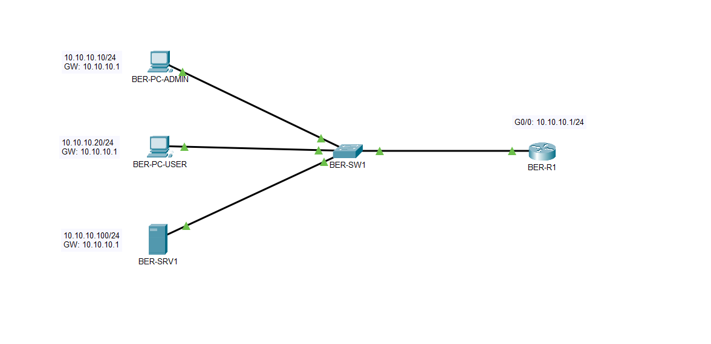

# Unternehmensnetzwerk Berlin–München

## Projekt

Planung, Aufbau und Dokumentation einer standortübergreifenden Unternehmensnetzwerk-Infrastruktur für die Rheinland Digital Services GmbH.

Das Projekt wird in Cisco Packet Tracer umgesetzt. Die Infrastruktur wird in 18 aufeinander aufbauenden Phasen erweitert. Jede Phase behandelt einen Themenbereich des CCNA 200-301 und bleibt Bestandteil derselben Netzwerktopologie.

## Ausgangssituation

Die Rheinland Digital Services GmbH betreibt eine Zentrale in Berlin und eine Niederlassung in München. Die vorhandenen Netzwerke sollen durch eine einheitliche, skalierbare und abgesicherte Infrastruktur ersetzt werden.

Für beide Standorte werden gemeinsame Standards für Adressierung, Segmentierung, Routing, Netzwerkdienste, Sicherheit und Dokumentation eingeführt.

## Projektauftrag

- Aufbau der physischen und logischen Netzwerktopologie
- Strukturierte IPv4- und IPv6-Adressierung
- Segmentierung durch VLANs
- Inter-VLAN- und standortübergreifendes Routing
- Redundanz mit Spanning Tree und EtherChannel
- Bereitstellung zentraler Netzwerkdienste
- Internetzugang über NAT und PAT
- Zugriffskontrolle mit ACLs
- Absicherung der Management- und Access-Ebene
- Integration von Mitarbeiter- und Gast-WLAN
- Monitoring und strukturiertes Troubleshooting
- Grundlagen der Netzwerkautomatisierung

## Standorte

| Standort | Funktion |
|---|---|
| Berlin | Hauptstandort, zentrale Dienste und Netzwerkmanagement |
| München | Niederlassung mit eigener Benutzer- und Netzwerkinfrastruktur |

## Adressierung

| Bereich | IPv4 | IPv6 |
|---|---|---|
| Berlin | `10.10.0.0/16` | `2001:db8:10::/48` |
| München | `10.20.0.0/16` | `2001:db8:20::/48` |
| WAN | `10.255.0.0/24` | `2001:db8:ff::/48` |

## Projektphasen

| Nr. | Thema | Status |
|---:|---|---|
| 01 | [Netzwerkgrundlagen, OSI- und TCP/IP-Modell](labs/01-netzwerkgrundlagen.md) | Abgeschlossen |
| 02 | Ethernet, MAC-Adressen, ARP und Switching | Offen |
| 03 | IPv4-Adressierung und Subnetting | Offen |
| 04 | IPv6-Adressierung und Neighbor Discovery | Offen |
| 05 | Cisco IOS, CLI und Geräte-Grundkonfiguration | Offen |
| 06 | VLANs und Trunking | Offen |
| 07 | Inter-VLAN-Routing | Offen |
| 08 | Spanning Tree Protocol und EtherChannel | Offen |
| 09 | Statisches Routing und Default Routes | Offen |
| 10 | OSPFv2 und OSPFv3 | Offen |
| 11 | DHCP, DNS, NTP und IP-Services | Offen |
| 12 | NAT und PAT | Offen |
| 13 | Access Control Lists | Offen |
| 14 | Netzwerksicherheit und Layer-2-Security | Offen |
| 15 | WLAN und Wireless-Security | Offen |
| 16 | Netzwerkmanagement und Troubleshooting | Offen |
| 17 | Automatisierung, APIs, JSON und SDN | Offen |
| 18 | Gesamtabnahme des Unternehmensnetzwerks | Offen |

## Aktueller Stand

In Phase 01 wurde das Grundnetz des Hauptstandorts Berlin aufgebaut.

- Router: `BER-R1`
- Switch: `BER-SW1`
- Administrations-PC: `BER-PC-ADMIN`
- Benutzer-PC: `BER-PC-USER`
- Webserver: `BER-SRV1`
- Netz: `10.10.10.0/24`
- Default Gateway: `10.10.10.1`

ARP, ICMP, TCP und HTTP wurden im Simulation Mode untersucht. Die lokale Erreichbarkeit und der Zugriff auf den Webserver wurden geprüft.



## Repository-Struktur

```text
.
├── README.md
├── images/
│   ├── 01-01-network-topology.png
│   ├── 01-02-arp-request-analysis.png
│   └── 01-03-http-request-analysis.png
├── labs/
│   └── 01-netzwerkgrundlagen.md
└── packet-tracer/
    └── rheinland-digital-network.pkt
```

## Dokumentationsstandard

- Eine zentrale `README.md` für das Gesamtprojekt
- Eine Markdown-Datei pro Projektphase unter `labs/`
- Maximal drei technische Screenshots pro Phase
- Einheitliche Dateinamen und relative Bildpfade
- Keine Zugangsdaten oder sensiblen Konfigurationswerte im Repository
- Ergebnisse werden erst nach erfolgreicher Verifikation dokumentiert
