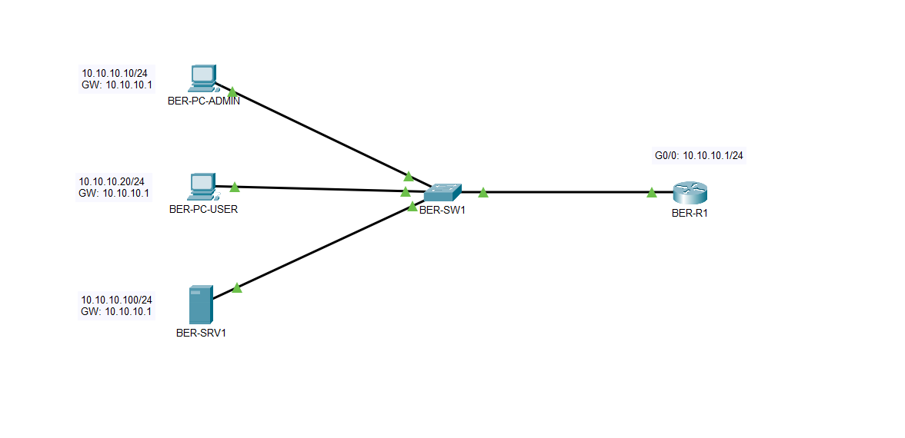
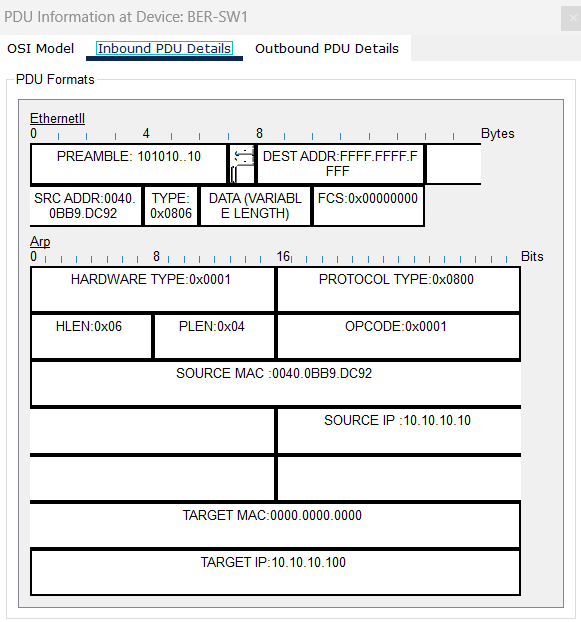
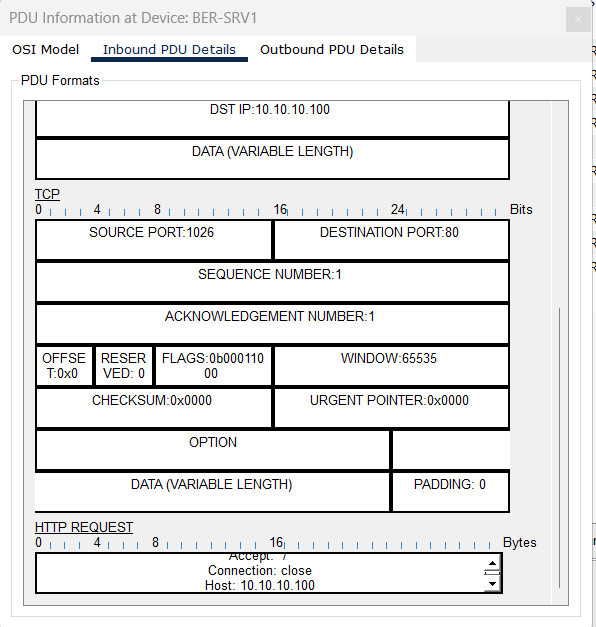

# 01 – Netzwerkgrundlagen

## Projektphase

Grundaufbau des Hauptstandorts Berlin für die Rheinland Digital Services GmbH.

## Ziel

Aufbau eines einfachen lokalen Netzwerks und Untersuchung der Kommunikation über Ethernet, ARP, ICMP, TCP und HTTP.

## Topologie

| Gerät | Funktion | IPv4-Adresse |
|---|---|---|
| BER-R1 | Router / Default Gateway | 10.10.10.1/24 |
| BER-SW1 | Layer-2-Switch | keine Management-IP |
| BER-PC-ADMIN | Administrations-PC | 10.10.10.10/24 |
| BER-PC-USER | Benutzer-PC | 10.10.10.20/24 |
| BER-SRV1 | Webserver | 10.10.10.100/24 |



## Verbindungen

| Quellgerät | Quellport | Zielgerät | Zielport |
|---|---|---|---|
| BER-PC-ADMIN | FastEthernet0 | BER-SW1 | FastEthernet0/1 |
| BER-PC-USER | FastEthernet0 | BER-SW1 | FastEthernet0/2 |
| BER-SRV1 | FastEthernet0 | BER-SW1 | FastEthernet0/10 |
| BER-SW1 | GigabitEthernet0/1 | BER-R1 | GigabitEthernet0/0 |

## Umsetzung

- Endgeräte und Server statisch im Netz `10.10.10.0/24` adressiert.
- `BER-R1` als Default Gateway mit `10.10.10.1` eingerichtet.
- Router-Interface `GigabitEthernet0/0` aktiviert.
- HTTP-Dienst auf `BER-SRV1` aktiviert.
- Router-Konfiguration in der `startup-config` gespeichert.

## Analyse

### ARP

Vor der Kommunikation mit dem Server ermittelt `BER-PC-ADMIN` dessen MAC-Adresse über einen ARP Broadcast.

- Source IP: `10.10.10.10`
- Target IP: `10.10.10.100`
- Destination MAC: `FFFF.FFFF.FFFF`
- Opcode: `0x0001` (`ARP Request`)



### TCP und HTTP

Der Webzugriff erfolgt über TCP-Port `80`. Nach dem TCP-Verbindungsaufbau sendet `BER-PC-ADMIN` einen HTTP Request an `BER-SRV1`.

- Client-Port: `1026`
- Server-Port: `80`
- Ziel: `10.10.10.100`
- Anwendung: `HTTP`



## Verifikation

- `GigabitEthernet0/0` auf `BER-R1` ist `up/up`.
- `BER-PC-ADMIN`, `BER-PC-USER`, `BER-SRV1` und `BER-R1` sind im lokalen Netz erreichbar.
- Die Webseite von `BER-SRV1` ist von beiden PCs über `http://10.10.10.100` erreichbar.
- ARP Request, ARP Reply, ICMP Echo Request und ICMP Echo Reply wurden im Simulation Mode geprüft.
- Der TCP-Verbindungsaufbau und der HTTP Request wurden im Simulation Mode geprüft.

## Dateien

```text
labs/01-netzwerkgrundlagen.md
images/01-01-network-topology.png
images/01-02-arp-request-analysis.png
images/01-03-http-request-analysis.png
packet-tracer/rheinland-digital-network.pkt
```
