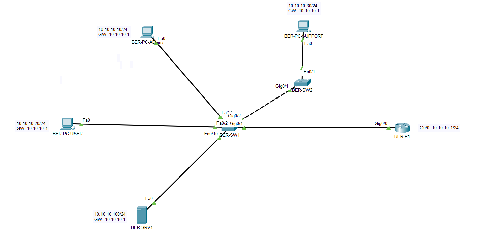
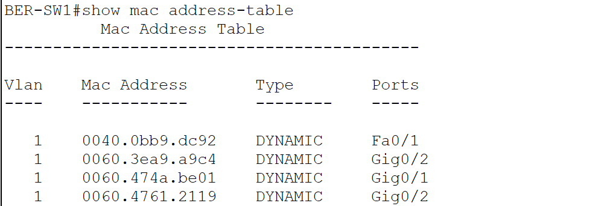
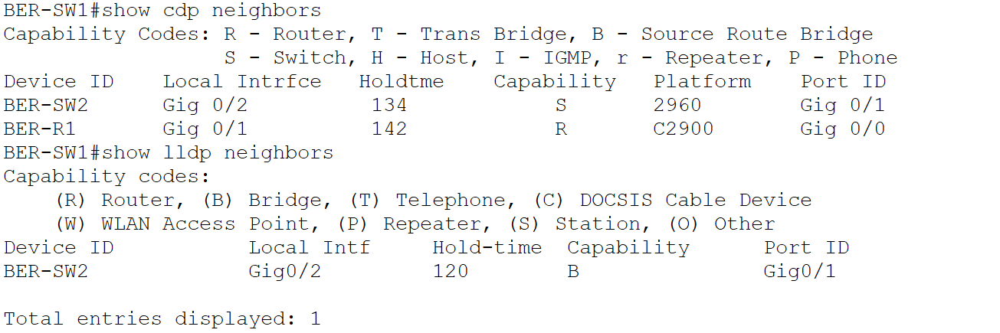

# 02 – Ethernet, MAC-Adressen, ARP und Switching

## Projektphase

Erweiterung des Access-Layers am Hauptstandort Berlin.

## Ziel

Erweiterung des bestehenden LANs um einen zweiten Access-Switch und einen zusätzlichen Arbeitsplatz. Untersucht wurden MAC-Learning, dynamische MAC-Einträge sowie die Nachbarerkennung mit CDP und LLDP.

## Topologie

| Gerät | Funktion | Adresse |
|---|---|---|
| BER-R1 | Router / Default Gateway | `10.10.10.1/24` |
| BER-SW1 | Zentraler Access-Switch | keine Management-IP |
| BER-SW2 | Erweiterung des Access-Layers | keine Management-IP |
| BER-PC-ADMIN | Administrations-PC | `10.10.10.10/24` |
| BER-PC-USER | Benutzer-PC | `10.10.10.20/24` |
| BER-PC-SUPPORT | Support-Arbeitsplatz | `10.10.10.30/24` |
| BER-SRV1 | Webserver | `10.10.10.100/24` |



## Verbindungen

| Quellgerät | Quellport | Zielgerät | Zielport |
|---|---|---|---|
| BER-SW1 | `GigabitEthernet0/2` | BER-SW2 | `GigabitEthernet0/1` |
| BER-SW2 | `FastEthernet0/1` | BER-PC-SUPPORT | `FastEthernet0` |

Die vorhandenen Verbindungen aus Phase 01 wurden beibehalten.

## Umsetzung

- `BER-SW2` zum bestehenden LAN hinzugefügt.
- IOS-Hostname auf `BER-SW1` und `BER-SW2` gesetzt.
- `BER-PC-SUPPORT` statisch mit `10.10.10.30/24` adressiert.
- `10.10.10.1` als Default Gateway eingetragen.
- Verwendete Switchports mit Beschreibungen dokumentiert.
- LLDP auf beiden Switches aktiviert.
- Switch-Konfigurationen in der `startup-config` gespeichert.

## MAC-Learning

`BER-SW1` lernte die MAC-Adresse von `BER-PC-SUPPORT` dynamisch über den Uplink zu `BER-SW2`:

```text
0060.3ea9.a9c4    DYNAMIC    Gig0/2
```

Nach dem Löschen der dynamischen MAC-Einträge wurde die Adresse durch neuen Datenverkehr erneut gelernt.



## Nachbarerkennung

CDP erkannte `BER-R1` und `BER-SW2`. LLDP erkannte `BER-SW2` über die Verbindung:

```text
BER-SW1 GigabitEthernet0/2
BER-SW2 GigabitEthernet0/1
```



## Verifikation

- Die Verbindung zwischen `BER-SW1` und `BER-SW2` ist aktiv.
- `BER-PC-SUPPORT` erreicht `BER-R1` unter `10.10.10.1` ohne Paketverlust.
- `BER-PC-SUPPORT` erreicht `BER-SRV1` unter `10.10.10.100` ohne Paketverlust.
- Der HTTP-Dienst auf `BER-SRV1` ist von `BER-PC-SUPPORT` erreichbar.
- Die MAC-Adresse von `BER-PC-SUPPORT` erscheint auf `BER-SW1` dynamisch an `GigabitEthernet0/2`.
- CDP und LLDP zeigen die erwarteten lokalen und entfernten Ports.

## Dateien

```text
labs/02-ethernet-switching.md
images/02-01-ethernet-switching-topology.png
images/02-02-mac-address-table.png
images/02-03-cdp-lldp-neighbors.png
packet-tracer/rheinland-digital-network-v02.pkt
```
