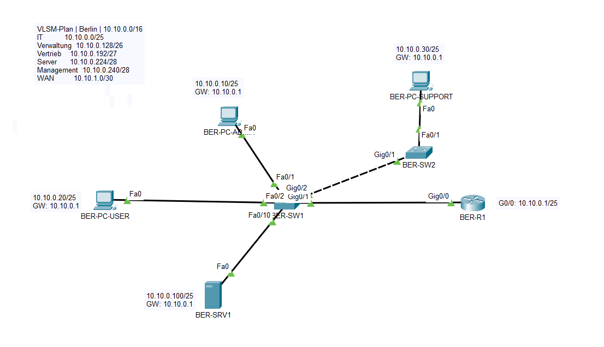
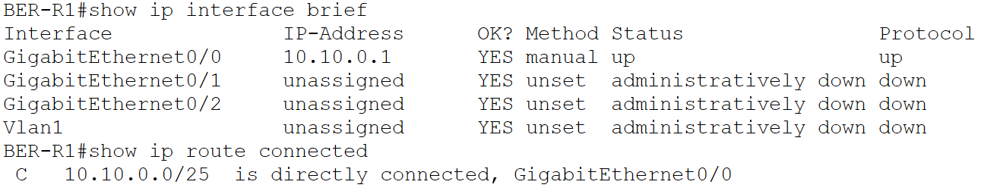
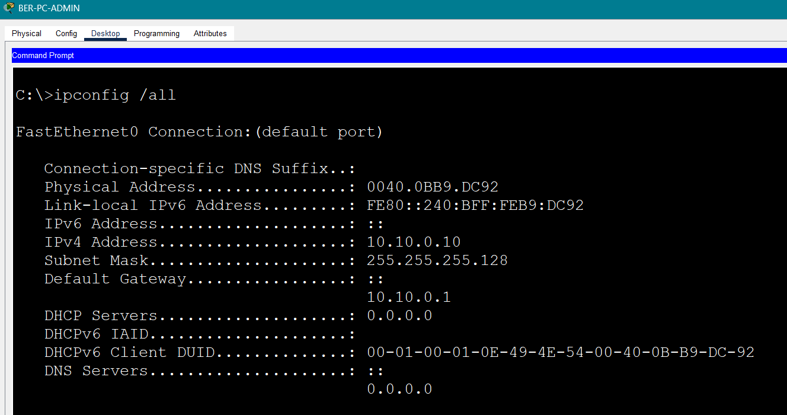

# 03 – IPv4-Adressierung und Subnetting

## Projektphase

IPv4-Adressierungsplanung für den Hauptstandort Berlin.

## Ziel

Der Adressbereich `10.10.0.0/16` wurde mit VLSM entsprechend dem geplanten Hostbedarf aufgeteilt. Das bestehende LAN wurde anschließend auf das erste Teilnetz migriert und geprüft.

## VLSM-Plan

| Bereich | Hostbedarf | Netz | Subnetzmaske | Nutzbarer Hostbereich | Broadcast |
|---|---:|---|---|---|---|
| IT | 100 | `10.10.0.0/25` | `255.255.255.128` | `10.10.0.1–10.10.0.126` | `10.10.0.127` |
| Verwaltung | 50 | `10.10.0.128/26` | `255.255.255.192` | `10.10.0.129–10.10.0.190` | `10.10.0.191` |
| Vertrieb | 25 | `10.10.0.192/27` | `255.255.255.224` | `10.10.0.193–10.10.0.222` | `10.10.0.223` |
| Server | 12 | `10.10.0.224/28` | `255.255.255.240` | `10.10.0.225–10.10.0.238` | `10.10.0.239` |
| Management | 10 | `10.10.0.240/28` | `255.255.255.240` | `10.10.0.241–10.10.0.254` | `10.10.0.255` |
| WAN | 2 | `10.10.1.0/30` | `255.255.255.252` | `10.10.1.1–10.10.1.2` | `10.10.1.3` |

## Aktive Adressierung

| Gerät | IPv4-Adresse | Gateway |
|---|---|---|
| BER-R1 | `10.10.0.1/25` | – |
| BER-PC-ADMIN | `10.10.0.10/25` | `10.10.0.1` |
| BER-PC-USER | `10.10.0.20/25` | `10.10.0.1` |
| BER-PC-SUPPORT | `10.10.0.30/25` | `10.10.0.1` |
| BER-SRV1 | `10.10.0.100/25` | `10.10.0.1` |



## Umsetzung

- VLSM-Plan nach absteigendem Hostbedarf erstellt.
- Überschneidungsfreie Teilnetze innerhalb von `10.10.0.0/16` festgelegt.
- `BER-R1 GigabitEthernet0/0` auf `10.10.0.1/25` umgestellt.
- Clients und Server in das aktive IT-Netz `10.10.0.0/25` migriert.
- Router-Konfiguration in der `startup-config` gespeichert.
- HTTP-Dienst auf `BER-SRV1` nach der Adressänderung neu gestartet.

## Verifikation

Die Routingtabelle zeigt das aktive Teilnetz als direkt verbunden:

```text
C 10.10.0.0/25 is directly connected, GigabitEthernet0/0
```



Die Clientkonfiguration wurde mit `ipconfig /all` geprüft.



Zusätzlich wurden folgende Funktionen erfolgreich geprüft:

- Erreichbarkeit des Default Gateways `10.10.0.1`
- Kommunikation zwischen den Clients
- Erreichbarkeit von `BER-SRV1` unter `10.10.0.100`
- HTTP-Zugriff auf `http://10.10.0.100`
- Negativtest mit einer Adresse außerhalb des aktiven `/25`-Netzes

## Hinweis

Die geplanten Netze für Verwaltung, Vertrieb, Server und Management werden in späteren Projektphasen mit VLANs und Inter-VLAN-Routing umgesetzt. In dieser Phase ist ausschließlich das IT-Netz aktiv.

## Dateien

```text
labs/03-ipv4-subnetting.md
images/03-01-vlsm-addressing-topology.png
images/03-02-router-connected-network.png
images/03-03-client-ip-configuration.png
packet-tracer/bms-enterprise-network-v03.pkt
```

