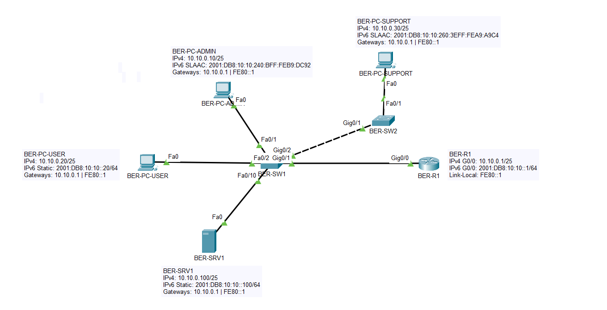
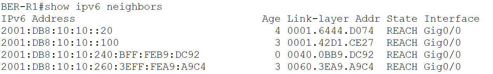
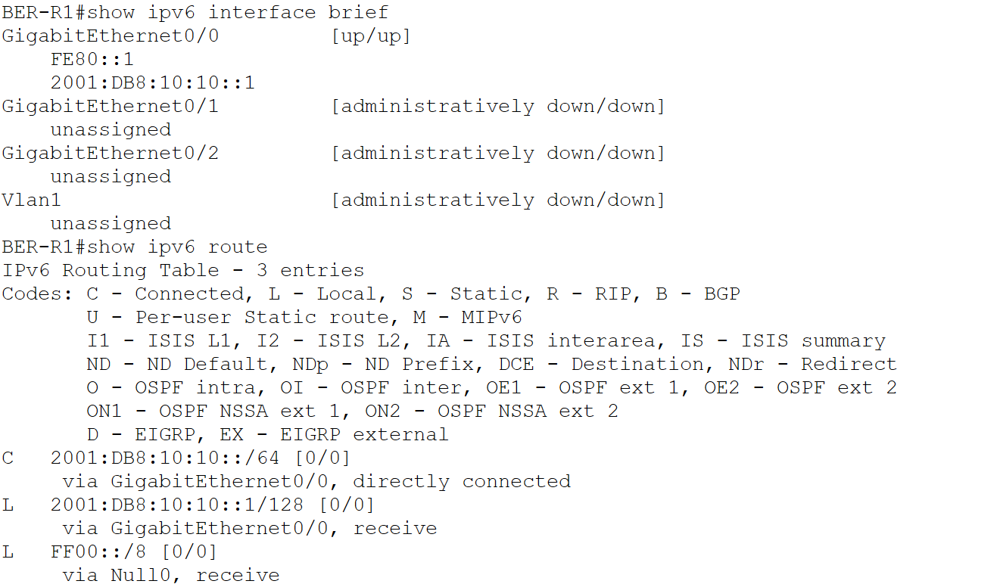

# 04 – IPv6-Adressierung und Neighbor Discovery

## Projektphase

Einführung von Dual Stack im bestehenden LAN am Hauptstandort Berlin.

## Ziel

Ergänzung der vorhandenen IPv4-Infrastruktur um IPv6. Verwendet wurden statische IPv6-Adressen, SLAAC, Link-Local-Adressen und Neighbor Discovery.

## Adressierung

| Gerät | IPv4 | IPv6 | Konfiguration |
|---|---|---|---|
| BER-R1 | `10.10.0.1/25` | `2001:DB8:10:10::1/64` | statisch |
| BER-R1 | – | `FE80::1` | Link-Local |
| BER-PC-ADMIN | `10.10.0.10/25` | `2001:DB8:10:10:240:BFF:FEB9:DC92/64` | SLAAC |
| BER-PC-USER | `10.10.0.20/25` | `2001:DB8:10:10::20/64` | statisch |
| BER-PC-SUPPORT | `10.10.0.30/25` | `2001:DB8:10:10:260:3EFF:FEA9:A9C4/64` | SLAAC |
| BER-SRV1 | `10.10.0.100/25` | `2001:DB8:10:10::100/64` | statisch |

IPv6-Standardgateway der Endgeräte:

```text
FE80::1
```



## Umsetzung

- IPv6-Unicast-Routing auf `BER-R1` aktiviert.
- Präfix `2001:DB8:10:10::/64` auf `GigabitEthernet0/0` eingerichtet.
- Link-Local-Adresse `FE80::1` auf dem Router festgelegt.
- `BER-PC-ADMIN` und `BER-PC-SUPPORT` über SLAAC adressiert.
- `BER-PC-USER` und `BER-SRV1` statisch adressiert.
- IPv4 blieb parallel aktiv.
- Router-Konfiguration in der `startup-config` gespeichert.

## Neighbor Discovery

Der Router lernte die IPv6-Nachbarn über NDP. Die Tabelle enthält IPv6-Adresse, MAC-Adresse, Status und lokales Interface.



`REACH` bestätigt, dass der jeweilige Nachbar zum Zeitpunkt der Prüfung erreichbar war.

## Routing

`GigabitEthernet0/0` arbeitet mit der Link-Local- und Global-Unicast-Adresse im Zustand `up/up`.

Die Routingtabelle enthält:

```text
C 2001:DB8:10:10::/64
L 2001:DB8:10:10::1/128
L FF00::/8
```



## Verifikation

- IPv6-Verbindung von `BER-PC-USER` zu `BER-R1` erfolgreich.
- IPv6-Verbindung von `BER-PC-SUPPORT` zu `BER-R1` erfolgreich.
- IPv6-Verbindung zwischen Client und `BER-SRV1` erfolgreich.
- SLAAC verteilte das Präfix und `FE80::1` als Gateway.
- Die Neighbor-Tabelle zeigte alle geprüften Geräte über `GigabitEthernet0/0`.
- Das Präfix `2001:DB8:10:10::/64` wurde als direkt verbunden angezeigt.

## Dateien

```text
labs/04-ipv6-neighbor-discovery.md
images/04-01-ipv6-dual-stack-topology.png
images/04-02-ipv6-neighbor-table.png
images/04-03-ipv6-interface-routing.png
packet-tracer/bms-enterprise-network-v04.pkt
```

