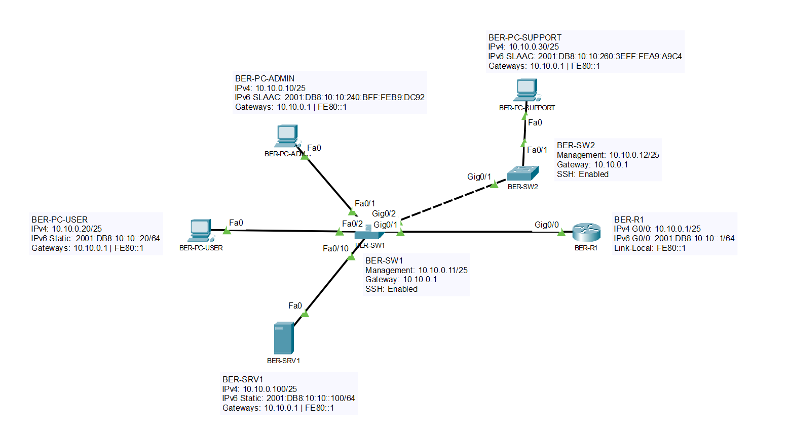
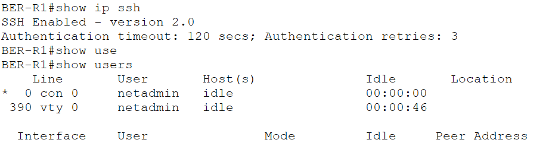
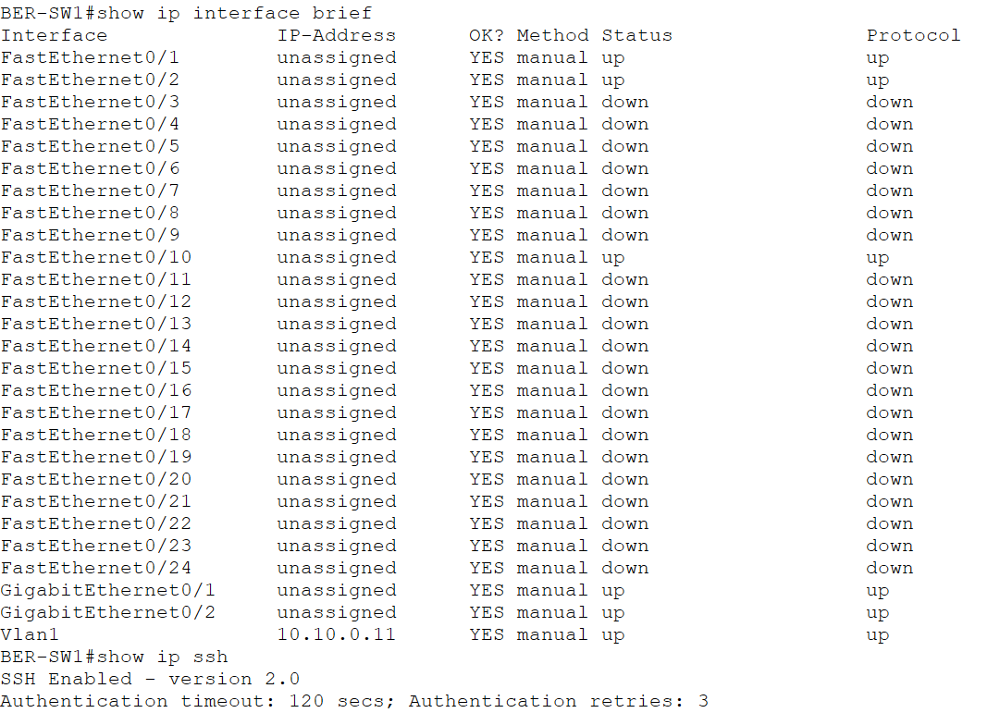

# 05 – Cisco IOS, CLI und Geräte-Grundkonfiguration

## Projektphase

Einheitliche Grundkonfiguration und sicherer Managementzugriff für die Netzwerkgeräte am Standort Berlin.

## Ziel

Die vorhandenen Router und Switches wurden mit einem einheitlichen IOS-Grundstandard ausgestattet. Zusätzlich wurden Management-Adressen und ein verschlüsselter SSH-Zugriff eingerichtet und geprüft.

## Management-Adressen

| Gerät | Management-Adresse | Schnittstelle | Standardgateway |
|---|---|---|---|
| `BER-R1` | `10.10.0.1/25` | `GigabitEthernet0/0` | – |
| `BER-SW1` | `10.10.0.11/25` | `Vlan1` | `10.10.0.1` |
| `BER-SW2` | `10.10.0.12/25` | `Vlan1` | `10.10.0.1` |

Die Management-Adressen auf `Vlan1` sind eine Übergangslösung. Die spätere Migration erfolgt in das vorgesehene Management-VLAN.



## Grundkonfiguration

Auf allen IOS-Geräten wurden folgende Einstellungen umgesetzt:

- IOS-Hostname entsprechend der Gerätebezeichnung
- Deaktivierung unnötiger DNS-Lookups bei fehlerhaften CLI-Eingaben
- lokales Administrationskonto mit Privilegstufe 15
- geschütztes Enable-Secret
- Verschlüsselung einfacher Kennwortdarstellungen
- rechtlicher MOTD-Hinweis
- Konsolenzugriff über die lokale Benutzerdatenbank
- automatisches Sitzungsende nach fünf Minuten Inaktivität
- synchrone Ausgabe von Systemmeldungen
- Speicherung der Konfiguration in der `startup-config`

Kennwörter, Secrets und private Schlüssel werden nicht im Repository dokumentiert.

## SSH-Konfiguration

Für `BER-R1`, `BER-SW1` und `BER-SW2` wurden folgende Einstellungen umgesetzt:

- Domainname `bms.local`
- RSA-Schlüssel mit 1024 Bit
- SSH Version 2
- Anmeldung über die lokale Benutzerdatenbank
- ausschließlich SSH auf den VTY-Leitungen
- Sitzungstimeout von fünf Minuten

Die SSH-Anmeldung wurde von `BER-PC-ADMIN` mit dem lokalen Administrationskonto geprüft.



## Switch-Management

`BER-SW1` und `BER-SW2` sind über ihre temporären Management-Adressen erreichbar.

Auf `BER-SW1` wurden die Management-SVI und SSH Version 2 geprüft:

```text
Vlan1    10.10.0.11    up    up
SSH Enabled - version 2.0
```



## Verifikation

Folgende Prüfungen wurden erfolgreich durchgeführt:

- `BER-R1` meldet `SSH Enabled - version 2.0`.
- Eine aktive SSH-Sitzung des Kontos `netadmin` wurde auf `vty 0` angezeigt.
- Die SSH-Anmeldung an `BER-R1` war erfolgreich an `BER-SW2` war erfolgreich.
- `BER-SW1` ist unter `10.10.0.11/25` erreichbar.
- `BER-SW2` ist unter `10.10.0.12/25` erreichbar.
- `Vlan1` auf `BER-SW1` befindet sich im Zustand `up/up`.
- Die Konfigurationen wurden in der jeweiligen `startup-config` gespeichert.

## Sicherheitsstand

Der aktuelle SSH-Zugriff dient dem technischen Grundaufbau. Die Management-Adressen befinden sich vorübergehend in `Vlan1`.

Die spätere Absicherung umfasst:

- Migration der Switch-Verwaltung in `VLAN 99`
- Beschränkung des SSH-Zugriffs auf autorisierte Management-Adressen
- Zugriffskontrolle über ACLs
- Deaktivierung ungenutzter Switchports
- weitere Maßnahmen zur Absicherung der Management-Ebene

## Dateien

```text
labs/05-cisco-ios-grundkonfiguration.md
images/05-01-ssh-session-verification.png
images/05-02-switch-management-ssh.png
images/05-03-management-topology.png
packet-tracer/bms-enterprise-network-v05.pkt
```

