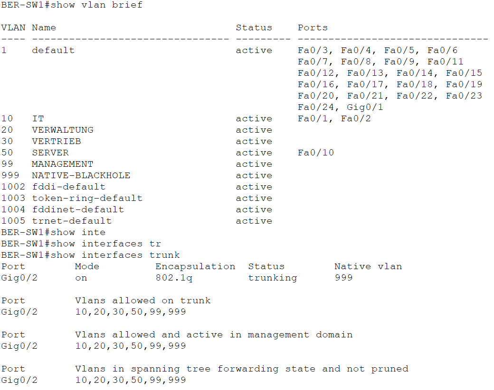
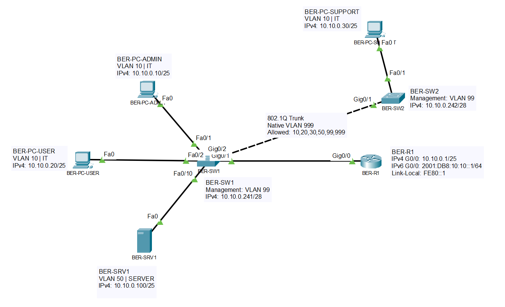
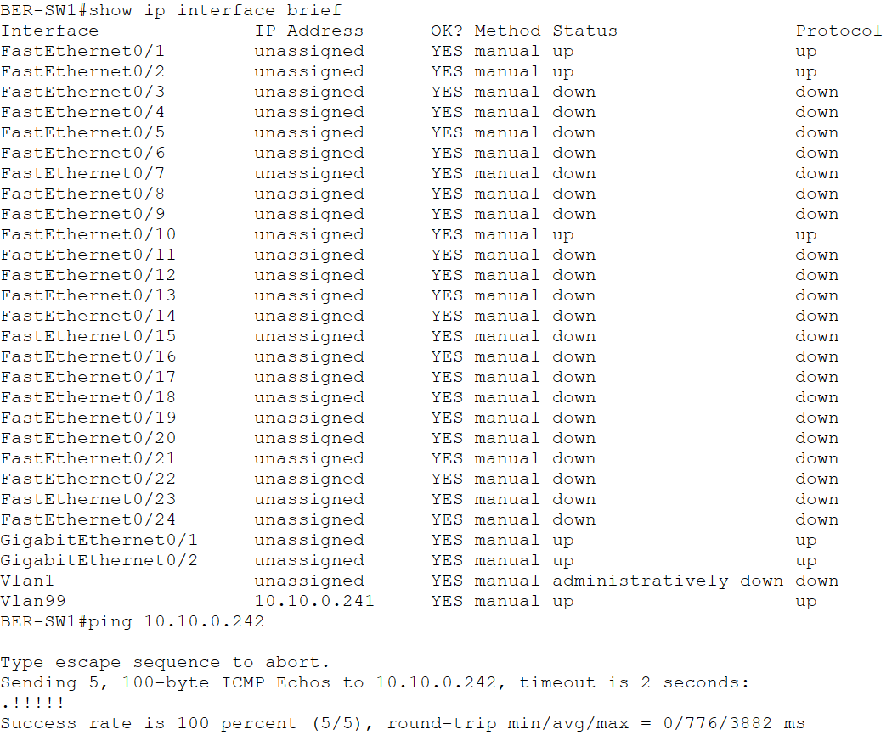

$Path = ".\labs\06-vlans-trunking.md"

$Markdown = @'
# 06 – VLANs und Trunking

## Projektphase

Segmentierung des Berliner Netzwerks mit VLANs und Einrichtung eines 802.1Q-Trunks zwischen den Access-Switches.

## Ziel

Die Endgeräte, der Server und die Management-Schnittstellen wurden getrennten VLANs zugewiesen. Zwischen `BER-SW1` und `BER-SW2` wurde ein 802.1Q-Trunk eingerichtet.

## VLAN-Plan

| VLAN | Name | Verwendung |
|---:|---|---|
| 10 | `IT` | IT-Arbeitsplätze |
| 20 | `VERWALTUNG` | Verwaltung |
| 30 | `VERTRIEB` | Vertrieb |
| 50 | `SERVER` | Server |
| 99 | `MANAGEMENT` | Switch-Management |
| 999 | `NATIVE-BLACKHOLE` | Native VLAN ohne Endgeräte |

## Portzuweisung

### BER-SW1

| Schnittstelle | Gerät | Modus | VLAN |
|---|---|---|---:|
| `FastEthernet0/1` | `BER-PC-ADMIN` | Access | 10 |
| `FastEthernet0/2` | `BER-PC-USER` | Access | 10 |
| `FastEthernet0/10` | `BER-SRV1` | Access | 50 |
| `GigabitEthernet0/1` | `BER-R1` | Access | 10 |
| `GigabitEthernet0/2` | `BER-SW2` | Trunk | 10, 20, 30, 50, 99, 999 |

### BER-SW2

| Schnittstelle | Gerät | Modus | VLAN |
|---|---|---|---:|
| `FastEthernet0/1` | `BER-PC-SUPPORT` | Access | 10 |
| `GigabitEthernet0/1` | `BER-SW1` | Trunk | 10, 20, 30, 50, 99, 999 |

## Trunk-Konfiguration

Der Trunk zwischen den Switches verwendet IEEE 802.1Q.

| Eigenschaft | Wert |
|---|---|
| Verbindung | `BER-SW1 Gi0/2` zu `BER-SW2 Gi0/1` |
| Encapsulation | `802.1Q` |
| Native VLAN | `999` |
| Erlaubte VLANs | `10,20,30,50,99,999` |

Die VLAN- und Trunk-Konfiguration wurde mit `show vlan brief` und `show interfaces trunk` geprüft.



## Netzwerktopologie

Die Arbeitsplätze `BER-PC-ADMIN`, `BER-PC-USER` und `BER-PC-SUPPORT` befinden sich in `VLAN 10`.

Der Server `BER-SRV1` befindet sich in `VLAN 50`. Die Management-Schnittstellen der Switches befinden sich in `VLAN 99`.



## Management-VLAN

Die temporären Management-Adressen auf `Vlan1` wurden entfernt. Beide Switches erhielten eine Management-SVI in `VLAN 99`.

| Gerät | Management-SVI | IPv4-Adresse | Standardgateway |
|---|---|---|---|
| `BER-SW1` | `Vlan99` | `10.10.0.241/28` | `10.10.0.254` |
| `BER-SW2` | `Vlan99` | `10.10.0.242/28` | `10.10.0.254` |

Die Adresse `10.10.0.254` ist für das spätere Inter-VLAN-Routing vorgesehen.

Die Kommunikation zwischen den Management-Schnittstellen wurde erfolgreich getestet.



## Verifikation

Folgende Prüfungen wurden erfolgreich durchgeführt:

- `BER-PC-ADMIN`, `BER-PC-USER` und `BER-PC-SUPPORT` befinden sich in `VLAN 10`.
- `BER-SRV1` befindet sich in `VLAN 50`.
- `BER-R1` ist über `BER-SW1 Gi0/1` an `VLAN 10` angebunden.
- Der Trunk verwendet `802.1Q`.
- Die Native VLAN ist an beiden Trunk-Enden `VLAN 999`.
- Über den Trunk werden ausschließlich `VLAN 10,20,30,50,99,999` übertragen.
- Die Kommunikation innerhalb von `VLAN 10` funktioniert über beide Switches.
- Die Kommunikation zwischen `VLAN 10` und `VLAN 50` ist ohne Inter-VLAN-Routing nicht möglich.
- `BER-SW1` erreicht `BER-SW2` über `VLAN 99`.
- `Vlan99` in der jeweiligen `startup-config` gespeichert.

## Aktueller Stand

Die VLAN-Segmentierung und der 802.1Q-Trunk zwischen `BER-SW1` und `BER-SW2` sind eingerichtet.

Die Endgeräte in `VLAN 10` können switchübergreifend kommunizieren. Der Server in `VLAN 50` ist von `VLAN 10` getrennt. Die Management-Schnittstellen der Switches sind über `VLAN 99` erreichbar.

Inter-VLAN-Routing ist noch nicht eingerichtet. Die Kommunikation zwischen `VLAN 10`, `VLAN 50` und `VLAN 99` wird in der nächsten Projektphase umgesetzt.

## Dateien

```text
labs/06-vlans-trunking.md
images/06-01-vlan-trunk-verification.png
images/06-02-vlan-topology.png
images/06-03-management-vlan-connectivity.png
packet-tracer/bms-enterprise-network-v06.pkt