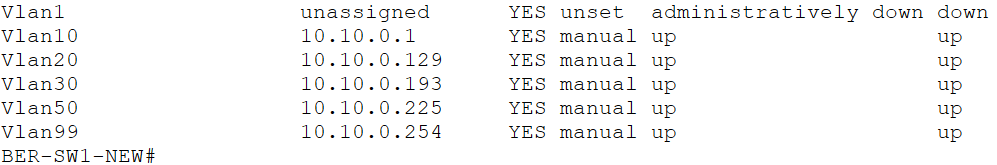
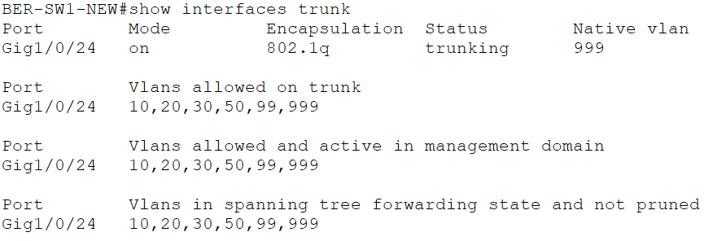
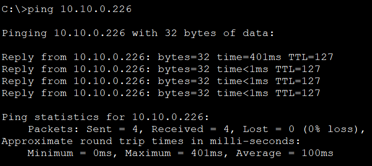

# 07 – Inter-VLAN-Routing

## Projektphase

Einrichtung des Inter-VLAN-Routings am Hauptstandort Berlin über einen Multilayer-Switch.

## Ziel

Die in der vorherigen Projektphase getrennten VLANs wurden über Layer-3-Schnittstellen auf `BER-SW1-NEW` routingfähig gemacht. Für die VLANs wurden SVIs als IPv4-Standardgateways eingerichtet und `ip routing` aktiviert.

## Multilayer-Switch

Der bisherige Layer-2-Switch `BER-SW1` wurde für diese Projektphase durch einen Multilayer-Switch ergänzt. Der neue Switch wurde als `BER-SW1-NEW` konfiguriert.

Die Layer-3-Routing-Funktion wurde mit folgendem IOS-Befehl aktiviert:

```text
ip routing
```

## SVI-Konfiguration

Für die relevanten VLANs wurden Switch Virtual Interfaces (SVIs) eingerichtet.

| VLAN | Name | Netz | SVI / Standardgateway |
|---:|---|---|---|
| 10 | `IT` | `10.10.0.0/25` | `10.10.0.1/25` |
| 20 | `VERWALTUNG` | `10.10.0.128/26` | `10.10.0.129/26` |
| 30 | `VERTRIEB` | `10.10.0.192/27` | `10.10.0.193/27` |
| 50 | `SERVER` | `10.10.0.224/28` | `10.10.0.225/28` |
| 99 | `MANAGEMENT` | `10.10.0.240/28` | `10.10.0.254/28` |

Die konfigurierten SVIs wurden mit `show ip interface brief` geprüft. Alle fünf verwendeten SVIs befanden sich im Zustand `up/up`.



## Portzuweisung

Nach dem Wechsel auf den Multilayer-Switch wurden die benötigten Verbindungen auf `BER-SW1-NEW` eingerichtet.

| Schnittstelle | Gerät | Modus | VLAN |
|---|---|---|---:|
| `GigabitEthernet1/0/1` | `BER-PC-ADMIN` | Access | 10 |
| `GigabitEthernet1/0/2` | `BER-PC-USER` | Access | 10 |
| `GigabitEthernet1/0/10` | `BER-SRV1` | Access | 50 |
| `GigabitEthernet1/0/24` | `BER-SW2 Gi0/1` | Trunk | 10, 20, 30, 50, 99, 999 |

## Trunk-Verbindung

Der Trunk zwischen `BER-SW1-NEW` und `BER-SW2` verwendet weiterhin IEEE 802.1Q.

| Eigenschaft | Wert |
|---|---|
| Verbindung | `BER-SW1-NEW Gi1/0/24` zu `BER-SW2 Gi0/1` |
| Encapsulation | `802.1Q` |
| Native VLAN | `999` |
| Erlaubte VLANs | `10,20,30,50,99,999` |

Die VLANs `10,20,30,50,99,999` wurden auf dem Trunk im STP-Forwarding-Zustand verifiziert.



## Server-VLAN

`BER-SRV1` wurde dem `VLAN 50` zugewiesen. Die bisherige IPv4-Adresse aus dem IT-Netz wurde an das Servernetz angepasst.

| Gerät | IPv4-Adresse | Subnetzmaske | Standardgateway | VLAN |
|---|---|---|---|---:|
| `BER-SRV1` | `10.10.0.226` | `255.255.255.240` | `10.10.0.225` | 50 |

Die IPv6-Konfiguration des Servers wurde in dieser Projektphase nicht verändert.

## Verifikation

Folgende Prüfungen wurden erfolgreich durchgeführt:

- Die SVIs für `VLAN 10`, `20`, `30`, `50` und `99` befinden sich im Zustand `up/up`.
- `ip routing` ist auf `BER-SW1-NEW` aktiviert.
- `BER-SW1-NEW Gi1/0/24` arbeitet als 802.1Q-Trunk zu `BER-SW2`.
- Die Native VLAN des Trunks ist `VLAN 999`.
- Auf dem Trunk sind ausschließlich `VLAN 10,20,30,50,99,999` freigegeben.
- `BER-SRV1` erreicht sein Standardgateway `10.10.0.225`.
- Die Kommunikation von `BER-PC-ADMIN` in `VLAN 10` zu `BER-SRV1` in `VLAN 50` wurde erfolgreich getestet.



## Aktueller Stand

Das Inter-VLAN-Routing am Hauptstandort Berlin ist über `BER-SW1-NEW` eingerichtet. Die konfigurierten SVIs übernehmen die Gateway-Funktion der jeweiligen IPv4-Netze.

Die Kommunikation zwischen `VLAN 10` und `VLAN 50` wurde erfolgreich nachgewiesen. Der bestehende Trunk zu `BER-SW2` überträgt weiterhin die vorgesehenen VLANs mit `VLAN 999` als Native VLAN.

## Dateien

```text
labs/07-inter-vlan-routing.md
images/07-svi-status.png
images/07-trunk-status.png
images/07-inter-vlan-routing-test.png
packet-tracer/bms-enterprise-network-v07.pkt
```
