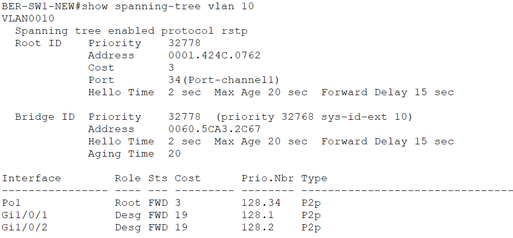
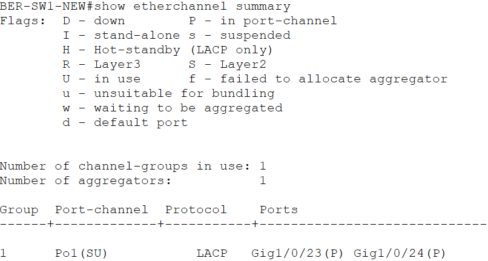
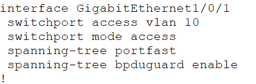

# 08 – Spanning Tree Protocol und EtherChannel

## Projektphase

Optimierung und Absicherung der Layer-2-Infrastruktur am Standort Berlin mit Rapid PVST+, LACP EtherChannel, PortFast und BPDU Guard.

## Ziel

Die beiden Switches wurden auf Rapid PVST+ umgestellt. Die Verbindung zwischen `BER-SW1-NEW` und `BER-SW2` wurde aus zwei physischen Gigabit-Verbindungen zu einem logischen LACP EtherChannel zusammengefasst. Endgeräteports wurden mit PortFast und BPDU Guard abgesichert.

## Rapid PVST+

Auf `BER-SW1-NEW` und `BER-SW2` wurde Rapid PVST+ aktiviert.

```text
spanning-tree mode rapid-pvst
```

Die Verifikation mit `show spanning-tree vlan 10` zeigte `rstp` als aktives Spanning-Tree-Protokoll. `Port-channel1` befand sich für VLAN 10 im Forwarding-Zustand.



## LACP EtherChannel

Zwischen den beiden Switches wurden zwei physische Gigabit-Verbindungen zu `Port-channel1` zusammengefasst.

| BER-SW1-NEW | BER-SW2 | Bündelung |
|---|---|---|
| `GigabitEthernet1/0/23` | `GigabitEthernet0/2` | `Port-channel1` |
| `GigabitEthernet1/0/24` | `GigabitEthernet0/1` | `Port-channel1` |

Als Aushandlungsprotokoll wird LACP im Modus `active` verwendet.

Der Port-Channel ist als 802.1Q-Trunk konfiguriert:

| Eigenschaft | Wert |
|---|---|
| Port-Channel | `Po1` |
| Protokoll | `LACP` |
| Modus | Layer 2 |
| Native VLAN | `999` |
| Erlaubte VLANs | `10,20,30,50,99,999` |

Die Verifikation mit `show etherchannel summary` ergab `Po1(SU)`. Beide physischen Schnittstellen wurden mit dem Status `P` erfolgreich in den Port-Channel aufgenommen.



## PortFast und BPDU Guard

PortFast und BPDU Guard wurden ausschließlich auf den verwendeten Access-Ports für Endgeräte aktiviert.

### BER-SW1-NEW

- `GigabitEthernet1/0/1` – `BER-PC-ADMIN`
- `GigabitEthernet1/0/2` – `BER-PC-USER`
- `GigabitEthernet1/0/10` – `BER-SRV1`

### BER-SW2

- `FastEthernet0/1` – `BER-PC-SUPPORT`

PortFast ermöglicht auf diesen Edge-Ports den direkten Übergang in den Forwarding-Zustand. BPDU Guard schützt die Ports vor unerwarteten BPDUs eines angeschlossenen Switches.

Die aktive Konfiguration wurde auf `BER-SW1-NEW Gi1/0/1` verifiziert.



## Verifikation

Folgende Prüfungen wurden erfolgreich durchgeführt:

- Rapid PVST+ ist auf den Berliner Switches aktiviert.
- Für VLAN 10 wird `rstp` als Spanning-Tree-Protokoll verwendet.
- `Port-channel1` verwendet LACP.
- `BER-SW1-NEW Gi1/0/23` und `Gi1/0/24` sind erfolgreich im EtherChannel gebündelt.
- `Port-channel1` arbeitet als Layer-2-Port-Channel und befindet sich im Zustand `SU`.
- Der Port-Channel transportiert `VLAN 10,20,30,50,99,999`.
- Die Native VLAN ist `VLAN 999`.
- PortFast und BPDU Guard sind auf den verwendeten Edge-Ports aktiviert.

## Aktueller Stand

Die Verbindung zwischen `BER-SW1-NEW` und `BER-SW2` besteht als LACP EtherChannel aus zwei physischen Gigabit-Verbindungen. Rapid PVST+ ist aktiviert und verarbeitet den Port-Channel als logische Layer-2-Verbindung.

Die verwendeten Endgeräteports sind mit PortFast und BPDU Guard konfiguriert. Die Konfiguration wurde auf beiden Switches in der `startup-config` gespeichert.

## Dateien

```text
labs/08-stp-etherchannel.md
images/08-01-lacp-etherchannel.png
images/08-02-rapid-pvst.png
images/08-03-portfast-bpduguard.png
packet-tracer/bms-enterprise-network-v08.pkt
```
