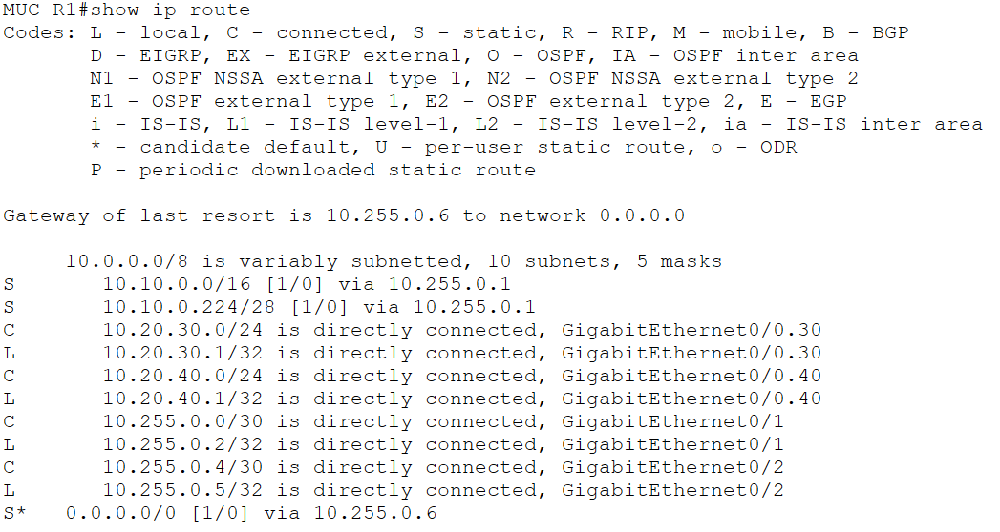
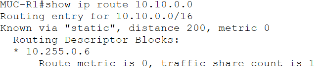
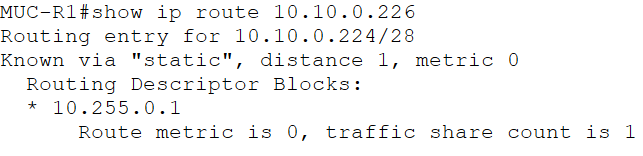

# 09 – Statisches Routing und Default Routes

## Projektphase

Temporäre Standortkopplung zwischen Berlin, München und ISP mit statischen IPv4-Routen.

## Ziel

Die Standorte Berlin und München wurden über separate WAN-Transitnetze verbunden. Für die Standortnetze wurden spezifische statische Routen und für den ISP-Pfad Default Routes eingerichtet. Zusätzlich wurden eine Floating Static Route als Backup-Pfad und Longest Prefix Match geprüft.

## WAN-Adressierung

| Verbindung | Gerät | Schnittstelle | IPv4-Adresse |
|---|---|---|---|
| Berlin – München | `BER-R1` | `Gi0/1` | `10.255.0.1/30` |
| Berlin – München | `MUC-R1` | `Gi0/1` | `10.255.0.2/30` |
| München – ISP | `MUC-R1` | `Gi0/2` | `10.255.0.5/30` |
| München – ISP | `ISP-R1` | `Gi0/0` | `10.255.0.6/30` |
| Berlin Transit | `BER-SW1-NEW` | `Gi1/0/22` | `10.255.0.9/30` |
| Berlin Transit | `BER-R1` | `Gi0/0` | `10.255.0.10/30` |

## München

Für den Standort München wurden die VLANs `30` und `40` über Router-on-a-Stick an `MUC-R1` angebunden.

| VLAN | Name | Netz | Gateway |
|---:|---|---|---|
| 30 | `VERTRIEB` | `10.20.30.0/24` | `10.20.30.1` |
| 40 | `SUPPORT` | `10.20.40.0/24` | `10.20.40.1` |

| Gerät | IPv4-Adresse | Standardgateway |
|---|---|---|
| `MUC-PC-VERTRIEB` | `10.20.30.10/24` | `10.20.30.1` |
| `MUC-PC-SUPPORT` | `10.20.40.10/24` | `10.20.40.1` |

## Statische Routen

`BER-R1` verwendet eine spezifische Route für München und eine Default Route in Richtung `MUC-R1`.

```text
10.20.0.0/16 → 10.255.0.2
0.0.0.0/0    → 10.255.0.2
```

`MUC-R1` verwendet eine spezifische Route für Berlin und eine Default Route zum ISP.

```text
10.10.0.0/16 → 10.255.0.1
0.0.0.0/0    → 10.255.0.6
```

Die Routingtabelle von `MUC-R1` zeigt außerdem die direkt verbundenen Netze `10.20.30.0/24`, `10.20.40.0/24`, `10.255.0.0/30` und `10.255.0.4/30`.



## Floating Static Route

Auf `MUC-R1` wurde für das Berliner Netz eine zusätzliche statische Route mit Administrative Distance `200` eingerichtet:

```text
10.10.0.0/16 → 10.255.0.6, AD 200
```

Im Normalbetrieb wurde die Route mit Administrative Distance `1` über `10.255.0.1` verwendet. Nach dem temporären Abschalten von `MUC-R1 Gi0/1` wurde die Backup-Route über `10.255.0.6` mit Administrative Distance `200` aktiv. Anschließend wurde `Gi0/1` wieder aktiviert.



## Longest Prefix Match

Zusätzlich zur allgemeinen Route `10.10.0.0/16` wurde auf `MUC-R1` eine spezifischere Route zum Berliner Servernetz eingerichtet:

```text
10.10.0.224/28 → 10.255.0.1
```

Die Abfrage für das Ziel `10.10.0.226` wählte die Route `10.10.0.224/28`. Damit wurde verifiziert, dass bei mehreren passenden Einträgen die Route mit dem längsten Präfix verwendet wird.



## Verifikation

Folgende Prüfungen wurden erfolgreich durchgeführt:

- Die WAN-Interfaces `MUC-R1 Gi0/1` und `Gi0/2` befinden sich im Zustand `up/up`.
- `BER-R1` besitzt eine spezifische Route zum Münchner Netz und eine Default Route in Richtung München.
- `MUC-R1` besitzt eine spezifische Route zum Berliner Netz und eine Default Route zum ISP.
- Die Floating Static Route mit Administrative Distance `200` wurde nach Ausfall des primären Pfads aktiv.
- Der primäre Pfad wurde nach dem Test wieder aktiviert.
- Für `10.10.0.226` wurde die spezifischere Route `10.10.0.224/28` ausgewählt.

## Aktueller Stand

Berlin, München und der ISP sind über statische IPv4-Routen logisch miteinander verbunden. München verfügt über die VLAN-Netze für Vertrieb und Support sowie einen Default-Pfad zum ISP. Für das Berliner Netz ist auf `MUC-R1` zusätzlich ein Backup-Pfad mit höherer Administrative Distance vorhanden.

Die Routingentscheidung anhand des längsten Präfixes wurde mit dem Berliner Servernetz verifiziert. Die vorgenommenen Konfigurationen wurden in der `startup-config` gespeichert.

## Dateien

```text
labs/09-static-routing.md
images/09-01-longest-prefix-match.png
images/09-02-floating-static-route.png
images/09-03-routing-table.png
packet-tracer/bms-enterprise-network-v09.pkt
```
